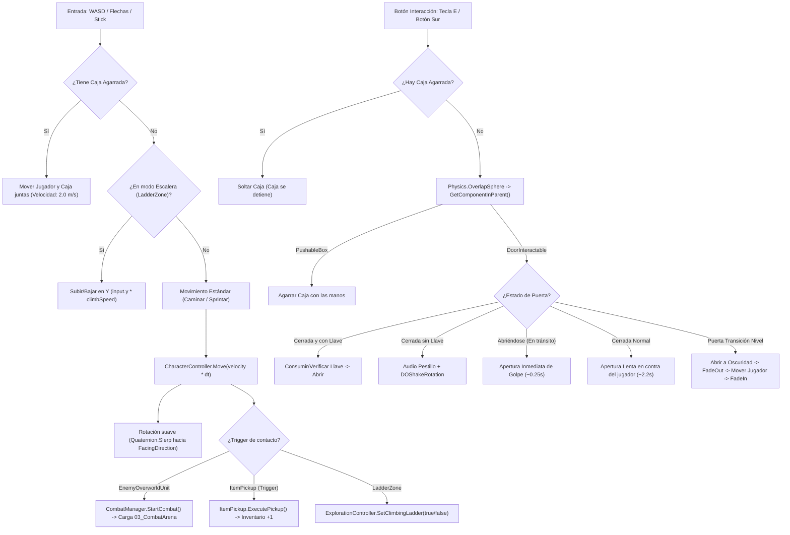

# 03.1 - Sistema de Exploración 3D (Exploration Controller, Interacciones y Puzles)

> [!NOTE] Ámbito Técnico & Arquitectura de Software
> Este documento detalla la implementación en C#, componentes de motor y física de Unity.
> Para las reglas de Game Design, diseño de experiencia, casos de error y parámetros del jugador, consultar:
> 👉 `Documentacion/GDD_Gaiden/03 - Mecánicas & Sistemas/03.1 - Métricas del Personaje & Locomoción.md` e `Interactuables de Entorno`.


## 🗺️ Reconstrucción: Exploración Top-Down en Perspectiva 3D

En la arquitectura modernizada en Unity:
- Se implementa una **perspectiva 3D cenital** con inclinación angular fija de $\approx 55^\circ$, profundidad tridimensional, sombras en tiempo real e iluminación atmosférica.
- El movimiento se traslada al espacio $X/Z$ utilizando `CharacterController` con soporte de física vertical (gravedad), rotación suave hacia el vector de avance y soporte nativo para escalones (`stepOffset = 0.45f`, `slopeLimit = 50f`).
- La cámara se orquesta mediante [[05 - Scripts C# (Arquitectura Unity)/Camera/CameraController.cs|CameraController]], con proyección en perspectiva, seguimiento cinemático suave (`Vector3.SmoothDamp`) y anticipación de movimiento (*look-ahead*).
- Detección de interacción tridimensional mediante `Physics.OverlapSphere` buscando en la jerarquía (`GetComponentInParent<IInteractable>()`) para cofres, puertas, cajas y objetos interactivos (`IInteractable`).
- Entrada totalmente migrada a **`UnityEngine.InputSystem`**, soportando simultáneamente teclado (WASD / Flechas), ratón y mandos (Xbox / PlayStation).
- Mecánicas avanzadas de interacción y puzles probadas y validadas en la escena [[01_Functional_Testing.unity]]:
  1. **Interacción con Puertas y Giro Dinámico ([[05 - Scripts C# (Arquitectura Unity)/Exploration/DoorInteractable.cs|DoorInteractable]])**:
     - Cálculo dinámico de rotación: el batiente gira siempre en contra de la posición del jugador (`CalculateOpenRotationAwayFrom`), impidiendo que golpee al avatar al abrirse.
     - Apertura de dos fases: Primera pulsación inicia apertura lenta y tensa (~2.2s con curva `Ease.InOutQuad`). Una segunda pulsación durante el recorrido acelera la apertura de golpe (*burst open*, ~0.25s) con impacto sonoro y elástico.
     - Puertas de seguridad con comprobación de llaves/tarjetas (`ItemId.RedKeyCard`) y sacudida de forcejeo si están atrancadas (`DOShakeRotation`).
     - Puertas de transición a nueva zona con fondo oscuro (`DarkVoid_Backdrop`), apertura hacia la oscuridad, fundido a negro (`ScreenFader.FadeOut`), teletransporte y reapertura (`ScreenFader.FadeIn`).
  2. **Verticalidad y Escaleras ([[05 - Scripts C# (Arquitectura Unity)/Exploration/LadderZone.cs|LadderZone]])**:
     - Navegación por escalones físicos y rampas continuas con `stepOffset`.
     - Escaleras de mano verticales con cambio automático a modo de escalada (subida/bajada en Y con W/S e inmunidad a gravedad).
  3. **Arrastre Activo de Cajas con las Manos ([[05 - Scripts C# (Arquitectura Unity)/Exploration/PushableBox.cs|PushableBox]])**:
     - Las cajas solo se desplazan si el jugador las agarra activamente (`IInteractable` con tecla `[E]`). El contacto pasivo por colisión libre no las mueve (evita bulldozing accidental).
     - Mientras se agarra una caja, la velocidad se restringe a paso pesado (`2.0 m/s`) y se desactiva el sprint.
  4. **Puntos Destino de Puzle (Sockets Azul y Rojo, [[05 - Scripts C# (Arquitectura Unity)/Exploration/BoxDestinationPoint.cs|BoxDestinationPoint]])**:
     - **Socket Azul (Intermedio)**: Punto de control en el suelo con material azul; reproduce feedback elástico y sonoro al encajar, pero permite seguir moviendo la caja.
     - **Socket Rojo (Definitivo)**: Meta final con material rojo; alinea la caja, la bloquea permanentemente (`IsLocked = true`, cinemática total y cese de interacción de agarre) y activa el peldaño de escalada.
  5. **Peldaño de Escalada Condicional (`Step_Ledge`)**:
     - El escalón que permite al `CharacterController` trepar sobre la caja permanece desactivado mientras la caja se mueve, impidiendo trepar antes de tiempo. Se despliega exclusivamente al bloquearse en el socket rojo final.

---

## 🏗️ Diagrama de Flujo de Entrada e Interacción



---

## 💻 Implementación en Unity C#

### 1. `ExplorationController.cs`
```csharp
using UnityEngine;
using UnityEngine.InputSystem;
using Game.Core;
using Game.Interfaces;

namespace Game.Exploration {
    [RequireComponent(typeof(CharacterController))]
    public class ExplorationController : MonoBehaviour {
        [Header("Velocidad de Movimiento")]
        [SerializeField] private float _walkSpeed = 3.5f;
        [SerializeField] private float _sprintSpeed = 5.8f;
        [SerializeField] private float _boxPushSpeed = 2.0f;
        [SerializeField] private float _rotationSpeed = 12f;

        [Header("Detección de Interacción")]
        [SerializeField] private float _interactionRadius = 1.6f;
        [SerializeField] private float _interactionDistance = 0.8f;
        [SerializeField] private LayerMask _interactLayers = ~0;

        [Header("Física y Verticalidad")]
        [SerializeField] private float _gravity = -15f;
        [SerializeField] private float _stepOffset = 0.45f;
        [SerializeField] private float _slopeLimit = 50f;

        private CharacterController _characterController;
        private Vector3 _moveDirection;
        private float _verticalVelocity;
        private bool _isSprinting;
        private float _lastInventoryToggleTime;
        private bool _isClimbingLadder;
        private float _ladderClimbSpeed = 3f;
        private PushableBox _grabbedBox;

        public Vector3 FacingDirection { get; private set; } = Vector3.forward;
        public bool IsMoving => _moveDirection.sqrMagnitude > 0.01f;
        public bool IsClimbingLadder => _isClimbingLadder;
        public bool IsGrabbingBox => _grabbedBox != null;

        private void Awake() {
            _characterController = GetComponent<CharacterController>();
            if (_characterController != null) {
                _characterController.center = Vector3.zero;
                _characterController.height = 2f;
                _characterController.radius = 0.4f;
                _characterController.stepOffset = _stepOffset;
                _characterController.slopeLimit = _slopeLimit;
            }
        }

        private void Update() {
            if (GameManager.Instance != null && GameManager.Instance.CurrentState != GameState.Exploration) {
                _moveDirection = Vector3.zero;
                return;
            }

            HandleInput();
            HandleInteractionInput();
        }

        private void FixedUpdate() {
            ApplyMovement();
        }

        private void HandleInput() {
            Vector2 inputVector = Vector2.zero;
            var keyboard = Keyboard.current;
            if (keyboard != null) {
                if (keyboard.wKey.isPressed || keyboard.upArrowKey.isPressed) inputVector.y += 1f;
                if (keyboard.sKey.isPressed || keyboard.downArrowKey.isPressed) inputVector.y -= 1f;
                if (keyboard.aKey.isPressed || keyboard.leftArrowKey.isPressed) inputVector.x -= 1f;
                if (keyboard.dKey.isPressed || keyboard.rightArrowKey.isPressed) inputVector.x += 1f;
            }

            var gamepad = Gamepad.current;
            if (gamepad != null) {
                Vector2 stick = gamepad.leftStick.ReadValue();
                if (stick.sqrMagnitude > 0.04f) inputVector = stick;
                else {
                    Vector2 dpad = gamepad.dpad.ReadValue();
                    if (dpad.sqrMagnitude > 0.04f) inputVector = dpad;
                }
            }

            if (_isClimbingLadder) {
                _verticalVelocity = inputVector.y * _ladderClimbSpeed;
                _moveDirection = new Vector3(inputVector.x * 0.5f, 0f, 0f);
            } else {
                Vector3 rawDir = new Vector3(inputVector.x, 0f, inputVector.y);
                _moveDirection = rawDir.sqrMagnitude > 1f ? rawDir.normalized : rawDir;

                _isSprinting = !IsGrabbingBox && ((keyboard != null && (keyboard.leftShiftKey.isPressed || keyboard.rightShiftKey.isPressed))
                            || (gamepad != null && (gamepad.buttonEast.isPressed || gamepad.leftStickButton.isPressed || gamepad.rightTrigger.isPressed)));

                if (!IsGrabbingBox && _moveDirection.sqrMagnitude > 0.001f) {
                    FacingDirection = _moveDirection.normalized;
                    Quaternion targetRotation = Quaternion.LookRotation(FacingDirection, Vector3.up);
                    transform.rotation = Quaternion.Slerp(transform.rotation, targetRotation, _rotationSpeed * Time.deltaTime);
                }
            }

            bool openInventory = (keyboard != null && (keyboard.iKey.wasPressedThisFrame || keyboard.tabKey.wasPressedThisFrame))
                              || (gamepad != null && (gamepad.startButton.wasPressedThisFrame || gamepad.selectButton.wasPressedThisFrame));

            if (openInventory && (Time.unscaledTime - _lastInventoryToggleTime > 0.35f) && GameManager.Instance != null) {
                _lastInventoryToggleTime = Time.unscaledTime;
                ReleaseBox();
                GameManager.Instance.ChangeState(GameState.Inventory);
            }
        }

        private void ApplyMovement() {
            if (_characterController == null) return;
            float currentSpeed = IsGrabbingBox ? _boxPushSpeed : (_isSprinting ? _sprintSpeed : _walkSpeed);
            Vector3 velocity = _moveDirection * currentSpeed;

            if (_isClimbingLadder) {
                velocity.y = _verticalVelocity;
            } else {
                if (_characterController.isGrounded) _verticalVelocity = -1f;
                else _verticalVelocity += _gravity * Time.fixedDeltaTime;
                velocity.y = _verticalVelocity;
            }

            _characterController.Move(velocity * Time.fixedDeltaTime);

            if (IsGrabbingBox) {
                _grabbedBox.MoveWithPlayer(_moveDirection, currentSpeed);
            }
        }

        private void HandleInteractionInput() {
            bool interactPressed = (Keyboard.current != null && Keyboard.current.eKey.wasPressedThisFrame)
                                || (Mouse.current != null && Mouse.current.leftButton.wasPressedThisFrame)
                                || (Gamepad.current != null && (Gamepad.current.buttonSouth.wasPressedThisFrame || Gamepad.current.buttonWest.wasPressedThisFrame));

            if (!interactPressed) return;

            if (IsGrabbingBox) {
                ReleaseBox();
                return;
            }

            Vector3 center = transform.position + Vector3.up * 0.3f + (FacingDirection * _interactionDistance);
            Collider[] colliders = Physics.OverlapSphere(center, _interactionRadius, _interactLayers);
            IInteractable bestCandidate = null;
            float bestDistance = float.MaxValue;

            foreach (var col in colliders) {
                if (col.transform.IsChildOf(transform)) continue;
                var interactable = col.GetComponentInParent<IInteractable>();
                if (interactable != null) {
                    float dist = Vector3.Distance(transform.position, col.transform.position);
                    if (dist < bestDistance) {
                        bestDistance = dist;
                        bestCandidate = interactable;
                    }
                }
            }

            bestCandidate?.Interact(this);
        }

        public void GrabBox(PushableBox box) => _grabbedBox = box;
        public void ReleaseBox() {
            if (_grabbedBox != null) {
                _grabbedBox.Release();
                _grabbedBox = null;
            }
        }

        public void SetClimbingLadder(bool isClimbing) {
            _isClimbingLadder = isClimbing;
            if (isClimbing) {
                ReleaseBox();
                _verticalVelocity = 0f;
            }
        }
    }
}
```

---

### 2. `PushableBox.cs`
```csharp
using UnityEngine;
using DG.Tweening;
using Game.Interfaces;

namespace Game.Exploration {
    [RequireComponent(typeof(Rigidbody))]
    public class PushableBox : MonoBehaviour, IInteractable {
        [SerializeField] private float _pushForce = 2.0f;
        [SerializeField] private GameObject _stepLedge; // Escalón condicional

        private Rigidbody _rb;
        private ExplorationController _currentGrabber;
        private bool _isLockedInPlace;

        public bool IsLocked => _isLockedInPlace;

        private void Awake() {
            _rb = GetComponent<Rigidbody>();
            _rb.isKinematic = true; // Inmóvil por defecto (evita empuje accidental)
            if (_stepLedge != null) _stepLedge.SetActive(false); // Inactivo hasta llegar a meta
        }

        public void Interact(ExplorationController player) {
            if (_isLockedInPlace) return;

            if (_currentGrabber == null) StartGrab(player);
            else Release();
        }

        private void StartGrab(ExplorationController player) {
            _currentGrabber = player;
            _rb.isKinematic = false;
            player.GrabBox(this);
        }

        public void Release() {
            if (_currentGrabber != null) {
                _currentGrabber = null;
                if (!_isLockedInPlace) _rb.isKinematic = true;
            }
        }

        public void MoveWithPlayer(Vector3 moveDir, float speed) {
            if (_isLockedInPlace) return;
            Vector3 targetVelocity = new Vector3(moveDir.x * speed, _rb.linearVelocity.y, moveDir.z * speed);
            _rb.linearVelocity = targetVelocity;
        }

        public void LockInPlace(Vector3 snapPosition) {
            _isLockedInPlace = true;
            Release();
            transform.position = new Vector3(snapPosition.x, transform.position.y, snapPosition.z);
            _rb.isKinematic = true;
            transform.DOPunchScale(new Vector3(0.1f, -0.05f, 0.1f), 0.35f);

            if (_stepLedge != null) {
                _stepLedge.SetActive(true);
                _stepLedge.transform.DOPunchScale(Vector3.one * 0.15f, 0.4f);
            }
        }

        public string GetInteractionPrompt() => _isLockedInPlace ? "" : (_currentGrabber != null ? "Soltar Caja [E]" : "Agarrar Caja [E]");
    }
}
```

---

### 3. `BoxDestinationPoint.cs`
```csharp
using UnityEngine;
using DG.Tweening;

namespace Game.Exploration {
    public enum BoxDestinationType {
        Blue, // Checkpoint intermedio (la caja se puede seguir empujando)
        Red   // Meta final (bloquea la caja permanentemente y activa el escalón)
    }

    [RequireComponent(typeof(Collider))]
    public class BoxDestinationPoint : MonoBehaviour {
        [SerializeField] private BoxDestinationType _destinationType = BoxDestinationType.Blue;
        [SerializeField] private AudioSource _audioSource;
        [SerializeField] private AudioClip _socketSound;

        private void OnTriggerEnter(Collider other) {
            var box = other.GetComponentInParent<PushableBox>();
            if (box == null || box.IsLocked) return;

            if (_audioSource != null && _socketSound != null) _audioSource.PlayOneShot(_socketSound);
            transform.DOPunchScale(Vector3.one * 0.15f, 0.3f);

            if (_destinationType == BoxDestinationType.Red) {
                box.LockInPlace(transform.position);
            }
        }
    }
}
```

---

### 4. `DoorInteractable.cs`
```csharp
using UnityEngine;
using DG.Tweening;
using Game.Interfaces;
using Game.Items;
using Game.Inventory;
using Game.UI;

namespace Game.Exploration {
    public class DoorInteractable : MonoBehaviour, IInteractable {
        [Header("Configuración de Apertura")]
        [SerializeField] private Transform _doorPivot;
        [SerializeField] private float _openAngle = 90f;
        [SerializeField] private float _slowOpenDuration = 2.2f;
        [SerializeField] private float _burstOpenDuration = 0.25f;

        [Header("Seguridad y Llaves")]
        [SerializeField] private bool _isLocked = false;
        [SerializeField] private ItemId _requiredKey = ItemId.None;

        [Header("Transición de Nivel")]
        [SerializeField] private bool _isLevelTransition = false;
        [SerializeField] private Transform _levelTransitionTargetSpawn;

        private bool _isOpen;
        private bool _isAnimating;
        private Tween _currentDoorTween;
        private Quaternion _closedRotation;
        private Quaternion _targetOpenRotation;

        public void Interact(ExplorationController player) {
            if (_isLocked) {
                if (_requiredKey != ItemId.None && InventorySystem.Instance.HasItem(_requiredKey)) {
                    _isLocked = false;
                    _doorPivot.DOPunchScale(Vector3.one * 0.08f, 0.3f);
                } else {
                    _doorPivot.DOShakeRotation(0.4f, new Vector3(0, 5f, 0), 10);
                    return;
                }
            }

            if (_isAnimating && !_isOpen) {
                // Segunda pulsación: Acelera apertura de golpe (Burst Open)
                BurstOpen();
                return;
            }

            if (!_isOpen) {
                _targetOpenRotation = CalculateOpenRotationAwayFrom(player);
                StartSlowOpen();
            } else {
                CloseDoor();
            }
        }

        private Quaternion CalculateOpenRotationAwayFrom(ExplorationController player) {
            // Elige la rotación que aleja la hoja del jugador
            Vector3 forward = transform.forward;
            Vector3 toPlayer = (player.transform.position - transform.position).normalized;
            float dot = Vector3.Dot(forward, toPlayer);
            float angle = (dot > 0f) ? -_openAngle : _openAngle;
            return _closedRotation * Quaternion.Euler(0f, angle, 0f);
        }

        private void StartSlowOpen() {
            _isOpen = true;
            _isAnimating = true;
            _currentDoorTween?.Kill();
            _currentDoorTween = _doorPivot.DOLocalRotate(_targetOpenRotation.eulerAngles, _slowOpenDuration)
                .SetEase(Ease.InOutQuad)
                .OnComplete(() => {
                    _isAnimating = false;
                    if (_isLevelTransition) ExecuteLevelTransition();
                });
        }

        private void BurstOpen() {
            _currentDoorTween?.Kill();
            _doorPivot.DOPunchScale(Vector3.one * 0.12f, 0.25f);
            _currentDoorTween = _doorPivot.DOLocalRotate(_targetOpenRotation.eulerAngles, _burstOpenDuration)
                .SetEase(Ease.OutQuad)
                .OnComplete(() => {
                    _isAnimating = false;
                    if (_isLevelTransition) ExecuteLevelTransition();
                });
        }

        private void ExecuteLevelTransition() {
            if (ScreenFader.Instance == null) return;
            ScreenFader.Instance.FadeOut(0.9f, () => {
                var player = GameObject.FindGameObjectWithTag("Player");
                if (player != null && _levelTransitionTargetSpawn != null) {
                    player.transform.position = _levelTransitionTargetSpawn.position;
                }
                CloseDoorImmediate();
                ScreenFader.Instance.FadeIn(0.8f);
            });
        }
    }
}
```

---

## 📑 Siguiente Paso Recomendado
Examinar la gestión de consumibles, llaves y el maletín en [[03.5 - Sistema de Inventario y Gestion de Recursos (Inventory, Herbs, Keys)]].
