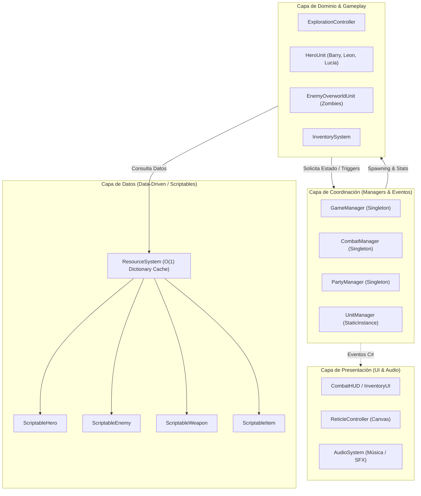
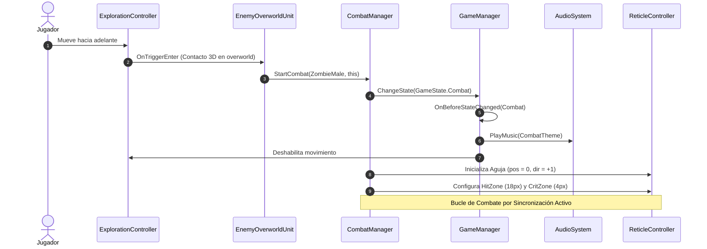
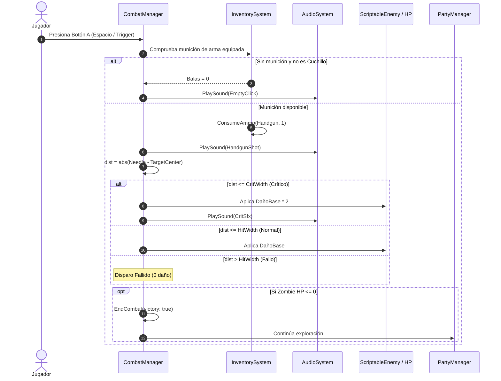
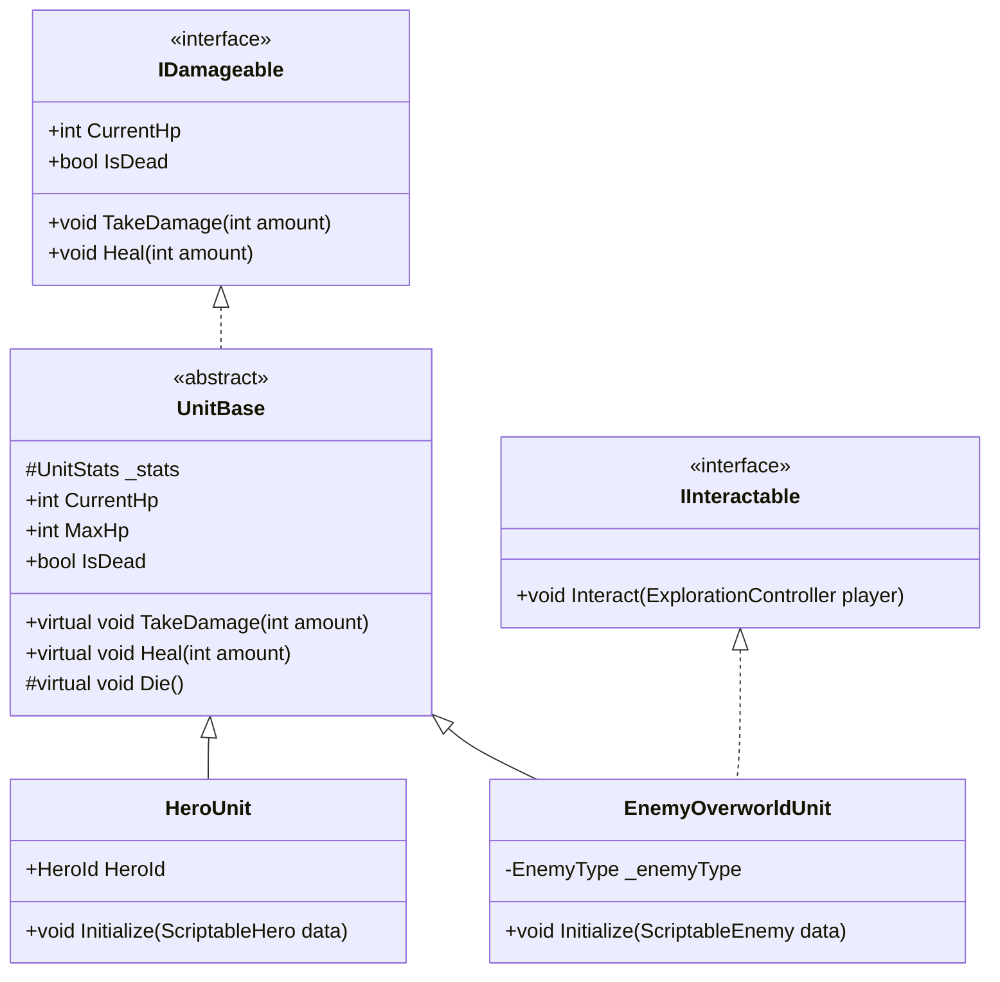
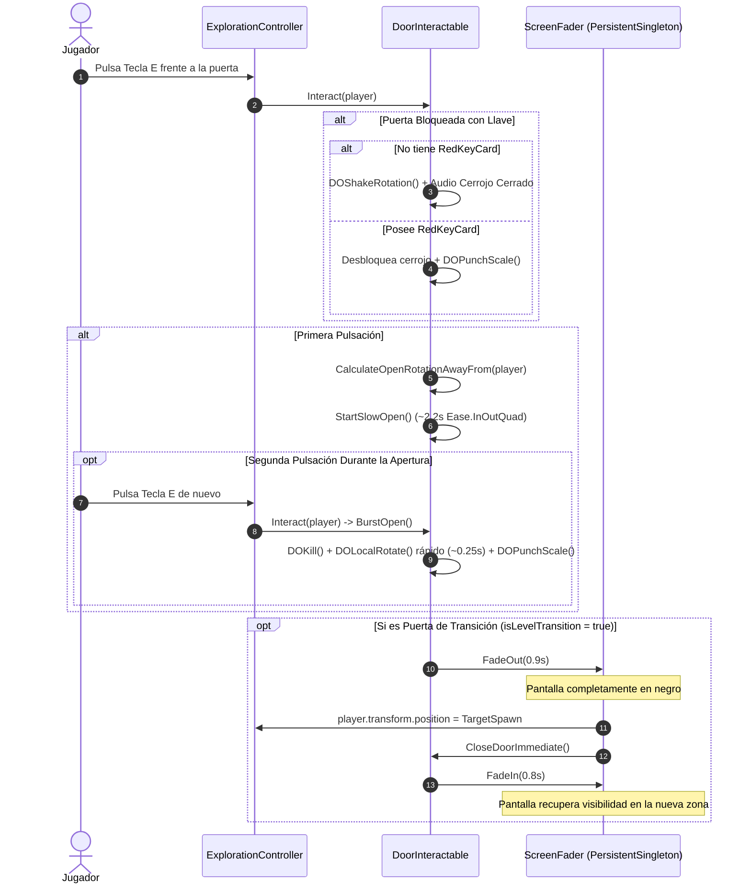

# 06.1 - Diagramas Mermaid de Arquitectura

Esta nota compila los diagramas visuales en **Mermaid** que describen el flujo de datos, la estructura de clases y las secuencias de interacción para el proyecto Resident Evil Gaiden en Unity.

---

## 1. Diagrama de Arquitectura de Capas



---

## 2. Diagrama de Secuencia: Transición de Exploración a Combate



---

## 3. Diagrama de Secuencia: Disparo y Cálculo de Daño



---

## 4. Diagrama de Clases: Jerarquía de Unidades e Interfaces



---

## 5. Diagrama de Secuencia: Agarre de Cajas y Sockets de Puzle

```mermaid
sequenceDiagram
    autonumber
    actor Player as Jugador
    participant Explo as ExplorationController
    participant Box as PushableBox
    participant Socket as BoxDestinationPoint
    participant Ledge as Step_Ledge (Escalón)

    Player->>Explo: Pulsa Tecla E frente a la caja
    Explo->>Box: Interact(player) -> StartGrab()
    Box->>Box: isKinematic = false
    Box->>Explo: player.GrabBox(this)
    Note over Explo,Box: Jugador arrastra la caja a 2.0 m/s (sin sprint)

    Player->>Explo: Desplaza la caja hacia Socket
    Box->>Socket: OnTriggerEnter(box)
    Socket->>Socket: DOPunchScale() + Reproduce Audio

    alt Socket Azul (Intermedio)
        Note over Socket,Box: Checkpoint alcanzado; la caja sigue siendo móvil
    else Socket Rojo (Definitivo)
        Socket->>Box: LockInPlace(socketPos)
        Box->>Explo: player.ReleaseBox()
        Box->>Box: isKinematic = true, IsLocked = true
        Box->>Ledge: SetActive(true) + DOPunchScale()
        Note over Box,Ledge: Caja fijada permanentemente. Jugador ya puede trepar sobre ella
    end
```

---

## 6. Diagrama de Secuencia: Puertas Direccionales y Transición de Nivel



