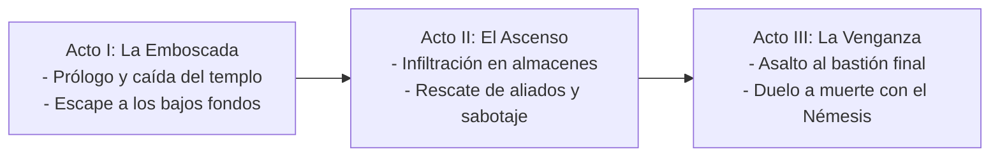

# 01.1 - Sinopsis & Estructura Argumental

> [!NOTE] Propósito de la Sección
> Definir la trama global del juego, la división en actos o capítulos, los giros narrativos y el balance entre elementos realistas y de ficción.

---

## 1. Premisa & Sinopsis Completa

### 1.1 Comienzo (El Detonante)
<!-- ¿Cómo empieza la historia? ¿Qué evento rompe el equilibrio inicial? -->
<!-- Ej: El secuestro del mandatario o la traición al clan ninja de Jack Bauer / Nikitonipongo -->

### 1.2 Desarrollo (Nudo & Escenarios del Conflicto)
<!-- ¿Qué obstáculos enfrenta el protagonista a través de las distintas localizaciones? -->
<!-- La infiltración en la ciudadela industrial, la confrontación con los tenientes enemigos y el descubrimiento de una conspiración interna -->

### 1.3 Desenlace (El Clímax y Resolución)
<!-- ¿Cómo termina la aventura? ¿Cómo se vence al antagonista final? ¿Qué desenlace tienen los personajes? -->

---

## 2. Estructura por Actos

### Acto I: La Invasión & Pérdida
- **Objetivo Narrativo:** Presentar al héroe, establecer su código ético y arrebatarle su hogar o proteger a su mentor.
- **Sucesos Clave:** <!-- RELLENAR -->
- **Punto de Giro 1:** <!-- Revelación que obliga al héroe a abandonar su refugio -->

### Acto II: La Travesía por el Territorio Enemigo
- **Objetivo Narrativo:** Cruzar la ciudad hostil, derrotar a los generales del bando enemigo y reunir información crucial.
- **Sucesos Clave:** <!-- RELLENAR -->
- **Punto de Giro 2:** <!-- Descubrimiento del arma definitiva o traición de un supuesto aliado -->

### Acto III: El Juicio Final
- **Objetivo Narrativo:** Asalto a la fortaleza principal y recuperación de la paz o cumplimiento de la misión.
- **Sucesos Clave:** <!-- Duelo contra el jefe supremo, destrucción de las instalaciones -->

---

## 3. Elementos Realistas vs. Ficción & Sobrenatural

| Elementos Realistas | Elementos de Ficción / Místicos |
| :--- | :--- |
| Coreografías marciales creíbles, anatomía humana, fatiga física | Técnicas ancestrales de ninjutsu, manipulación de sombras y fuego |
| Armamento tradicional (katanas, shurikens, ganchos) | Artefactos antiguos imbuidos de energía espiritual |
| Entornos urbanos industriales degradados y almacenes | Criaturas modificadas o autómatas guardianes arcanos |

---

## 4. Enlaces Relacionados
- [[01.2 - Lore, Reglas del Universo & Setting]]
- [[04.1 - Índice de Personajes Jugables (Héroes)]]
- [[07.3 - Guión de Cinemáticas, Storyboards & Triggers]]
