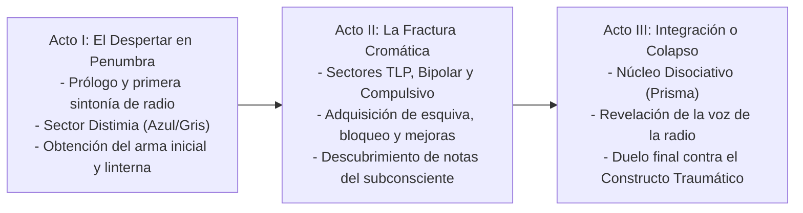

# 01.1 - Sinopsis & Estructura Argumental

> [!NOTE] Propósito de la Sección
> Definir la trama global del juego, la división en actos o capítulos, los giros narrativos y el balance entre elementos realistas y de ficción.

---

## 1. Premisa & Sinopsis Completa

### 1.1 Comienzo (El Detonante)
El protagonista (el Investigador) despierta aturdido sobre un suelo de concreto en una instalación desolada y en penumbra, sin recordar con claridad cómo llegó allí. El silencio se quiebra por el chirrido de estática de una radio analógica cercana. Al sintonizarla, una voz distorsionada y serena le advierte que el lugar se encuentra sellado y en colapso inminente, instándolo a ponerse en pie y buscar una salida antes de que las sombras del entorno terminen por desintegrarlo.

### 1.2 Desarrollo (Nudo & Escenarios del Conflicto)
Con una linterna de haz tenue y una pistola básica de percusión, el Investigador se adentra en las entrañas de la instalación. Rápidamente comprende que la arquitectura no responde a leyes físicas ordinarias: cada sector está bañado por una iluminación de claroscuro característica y habitado por aberraciones grotescas cuyo comportamiento y fisionomía reflejan estados psíquicos extremos (la pesadez inamovible de la distimia, la rabia reactiva del trastorno límite, los contrastes maníacos de la bipolaridad). A través de terminales de radio, notas fragmentadas y el hallazgo de nuevas armas y componentes de mejora, el Investigador fortalece su cuerpo y mente, desbloqueando habilidades esenciales de bloqueo y evasión para sobrevivir al entorno.

### 1.3 Desenlace (El Clímax y Resolución)
Al alcanzar el sector más profundo (el Núcleo Disociativo fragmentado en aberración cromática de prisma), se produce la revelación: la instalación no es un complejo físico militar ni corporativo, sino el mapa arquitectónico de su propia psique traumatizada, y la voz de la radio es el último bastión de su conciencia lúcida. Para escapar y regresar a la vigilia, el protagonista debe confrontar y superar al Constructo Traumático (la encarnación de todas las patologías reprimidas), logrando la integración psicológica o quedando atrapado para siempre en la locura.

---

## 2. Estructura por Actos

### Acto I: El Despertar en Penumbra
- **Objetivo Narrativo:** Establecer la vulnerabilidad del Investigador, la mecánica diegética de la radio y el tono claustrofóbico.
- **Sucesos Clave:** Despertar en el sector frío azulado (Distimia), evasión de las primeras entidades pesadas, aprendizaje del combate rítmico en primera persona y escape hacia el distribuidor central.
- **Punto de Giro 1:** El primer mensaje de radio revela que las salidas convencionales no existen; el avance solo es posible abriendo las compuertas de contención de los sectores patológicos contiguos.

### Acto II: La Fractura Cromática
- **Objetivo Narrativo:** Descenso a las capas más agresivas de la psique, intensificando la presión de recursos y la progresión del arsenal.
- **Sucesos Clave:** Travesía por el ala industrial naranja/teal (Trastorno Límite) y las salas de sobrecarga lumínica (Bipolaridad). El Investigador desbloquea habilidades de estamina (esquiva/bloqueo) y mejora la cadencia, daño y recarga de sus armas.
- **Punto de Giro 2:** Hallazgo de registros grabados que contradicen la realidad externa y revelan que la radio emite desde su propia frecuencia cerebral.

### Acto III: Integración o Colapso
- **Objetivo Narrativo:** Confrontación con el núcleo del trauma y resolución del viaje psicológico.
- **Sucesos Clave:** Llegada al sector de refracción cromática disociativa (TID). Duelo multifase contra el Constructo Traumático, combinando todo el dominio rítmico y defensivo acumulado.

---

## 3. Elementos Realistas vs. Ficción & Simbolismo Psicológico

| Elementos Realistas / Tácticos | Elementos de Ficción / Simbolismo Subtextual |
| :--- | :--- |
| Balística funcional, retroceso, cadencia y capacidad de cargadores reales | Aberraciones anatómicas concebidas como metáforas corporales del trauma |
| Desgaste de estamina física, fatiga y lentitud de reacción bajo estrés | Arquitectura maleable que se expande o deforma según el estado anímico |
| Equipos analógicos degradados (válvulas, cables expuestos, transistores de radio) | Iluminación de claroscuro con códigos cromáticos de salud mental no clínicos |
| Maletín de suministros con slots finitos y gestión de munición | Frecuencias de radio que sintonizan pensamientos y recuerdos fragmentados |

---

## 4. Enlaces Relacionados
- [[01.2 - Lore, Reglas del Universo & Setting]]
- [[04.1 - Índice de Personajes Jugables (Héroes)]]
- [[07.3 - Guión de Cinemáticas, Storyboards & Triggers]]
