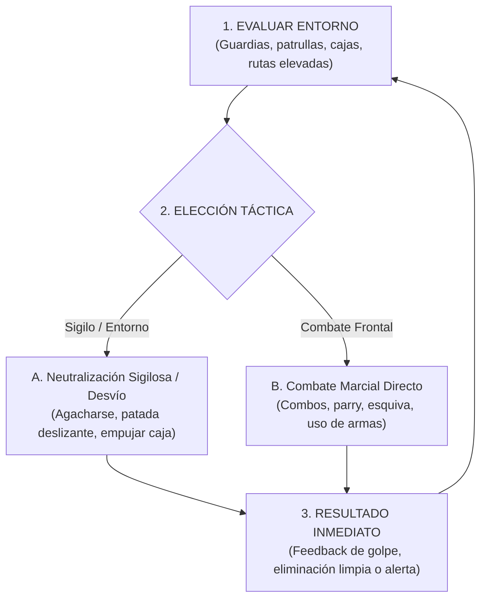

# 02.1 - Core Game Loop & Dinámicas Clave

> [!NOTE] Propósito de la Sección
> Definir con absoluta claridad el ciclo de juego en sus tres escalas temporales (segundo a segundo, minuto a minuto y por sesión) y las dinámicas emergentes que surgen del diseño.

---

## 1. El Ciclo de Juego (Game Loops)

### 1.1 Bucle Primario (Segundo a Segundo: El Encuentro Táctico)

### 1.2 Bucle Secundario (Minuto a Minuto: La Habitación / Desafío)
1. **Entrada a Zona Desconocida:** Se presenta una sala con obstáculos físicos (escaleras, puertas bloqueadas, trampas de fuego) y patrullas enemigas.
2. **Resolución de Puzle / Combate:** El jugador limpia la sala o la evade, interactúa con cajas empujables o interruptores para abrir accesos.
3. **Recompensa Inmediata:** Recoge botiquines, munición, dinero o un coleccionable oculto.
4. **Guardado:** Alcanza un [[03.3 - Salud, Estados Alterados, Muerte & Checkpoints|Checkpoint]] seguro.

### 1.3 Bucle Terciario (Por Sesión: La Campaña)
1. **Completar Misiones de Nivel:** Derrotar al boss de zona o alcanzar el objetivo primordial.
2. **Progreso & Desbloqueo:** Invertir experiencia (XP) y dinero en nuevas técnicas marciales, mejoras de vida o armas en el Hub.
3. **Avance en la Historia:** Nueva revelación argumental y apertura del siguiente escenario.

---

## 2. Dinámicas Clave Emergentes

- **Dinámica "Gato y Ratón":** El jugador comete un fallo de ruido, alerta a un guardia con escudo, se retira rápidamente al conducto de ventilación, espera 15 segundos a que la IA baje el nivel de alerta y contraataca por la espalda.
- **Dinámica "Uso del Entorno como Arma":** Patear una caja interactuable hacia un grupo de enemigos para derribarlos sin gastar estamina.
- **Dinámica "Riesgo vs. Recompensa":** Arriesgarse a tomar la ruta de plataformas móviles sobre pinchos para conseguir una Medalla Oculta en vez del camino llano vigilado.

---

## 3. Enlaces Relacionados
- [[02.2 - Modos de Juego & Estructura]]
- [[02.3 - Motivación del Jugador (Problema-Resolución-Recompensa)]]
