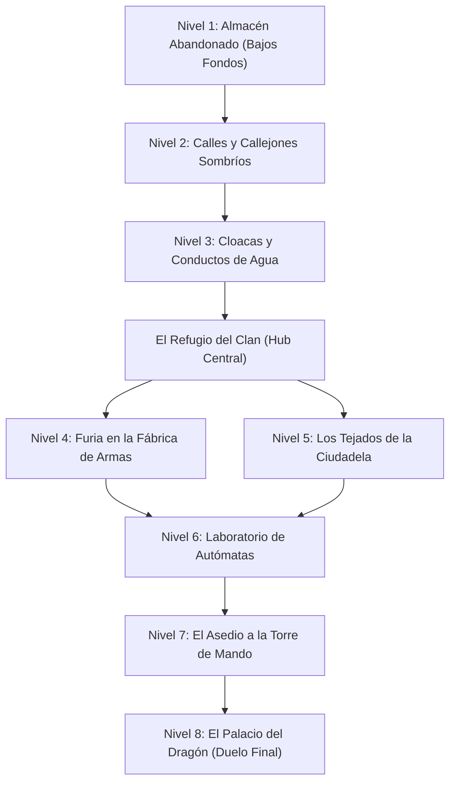

# 02.2 - Modos de Juego & Estructura

> [!NOTE] Propósito de la Sección
> Especificar los distintos modos en los que el usuario puede jugar, así como la arquitectura de progresión general de la campaña.

---

## 1. Modo Historia (Campaña Principal)

### 1.1 Modalidad Individual (Single Player)
- El jugador controla a Jack Bauer a lo largo de los 8 niveles de la campaña.
- Enfoque narrativo completo con cinemáticas intermedias y diálogos de historia.

### 1.2 Modalidad Cooperativa (Co-op Local & Online para 2 Jugadores)
- El segundo jugador toma el control de Dude (segundo ninja con estadísticas equilibradas y árbol de habilidades complementario).
- **Ajustes de Balance en Co-op:**
  - Los enemigos simples tienen un 25% más de salud y aumentan su agresividad.
  - Mecánica de "Reanimación en el Suelo": Si un jugador cae, el otro tiene 10 segundos para interactuar y revivirlo antes de volver al último checkpoint.
  - Puzles coordinados: Se requieren dos placas de presión simultáneas o un jugador empuja una caja mientras el otro activa una palanca lejana.

---

## 2. Modos Adicionales (Desbloqueables Post-Lanzamiento / Endgame)

### 2.1 Modo Desafío Arcade (Boss Rush & Puntuación)
- Recorrer los combates contra jefes sin interrupción narrativa, compitiendo por tiempo récord y puntuación de estilo.

### 2.2 Modo Supervivencia / Horda (Multiplayer / Desafío)
- Oleadas progresivas de enemigos en arenas cerradas con recompensas de experiencia rápida.

---

## 3. Estructura de Progresión de la Campaña

