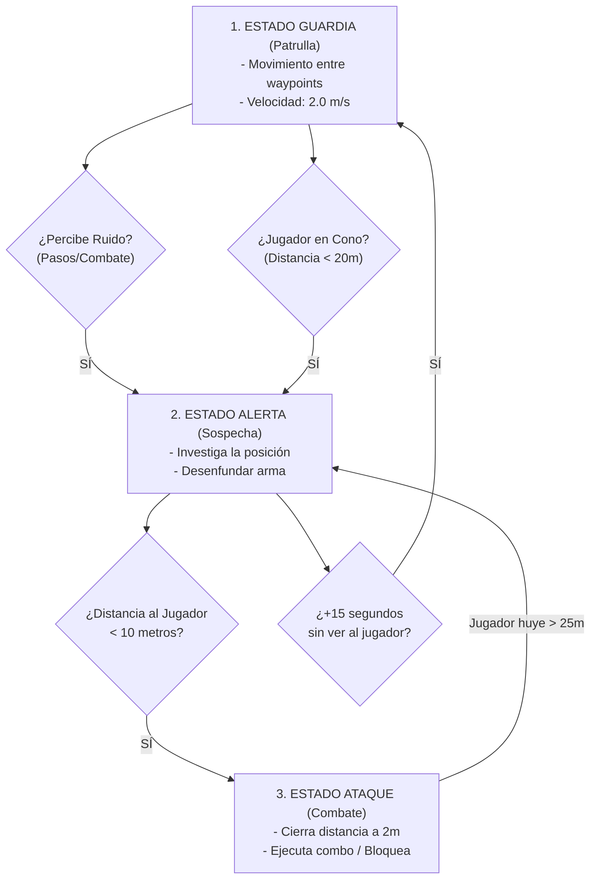

# 04.4 - Guía de IA de Enemigos & Árbol de Comportamiento

> [!NOTE] Metodología Dragon Ninja
> Define la lógica sensorial y el diagrama de estados de la inteligencia artificial de los enemigos estándar.

---

## 1. Diagrama Oficial de Comportamiento de IA

---

## 2. Sensores & Reglas de Detección

### 2.1 Percepción Visual (Cono de Visión)
- **Ángulo de Visión:** `90 grados` frontales.
- **Rango Máximo diurno / zonas iluminadas:** `20 metros`.
- **Rango en Penumbra / Zonas oscuras:** Reducido a `6 metros`.
- **Si el jugador está agachado tras cobertura:** Detección visual = 0%.

### 2.2 Percepción Auditiva (Oído)
- **Caminar en sigilo (Agachado):** `0 metros` de ruido.
- **Correr estándar:** `8 metros` de radio esférico.
- **Sprint / Golpear objetos o romper barriles:** `16 metros` de radio.

---

## 3. Coordinación de Grupo & Tokens de Ataque
- Para evitar que 5 enemigos golpeen simultáneamente haciendo imposible la esquiva, se emplea un sistema de **Tokens de Ataque**:
  - Máximo **2 enemigos** tienen el token activo de golpear a la vez.
  - Los enemigos restantes sin token mantienen la distancia, flanquean al jugador o realizan burlas para mantener la tensión sin saturar.
