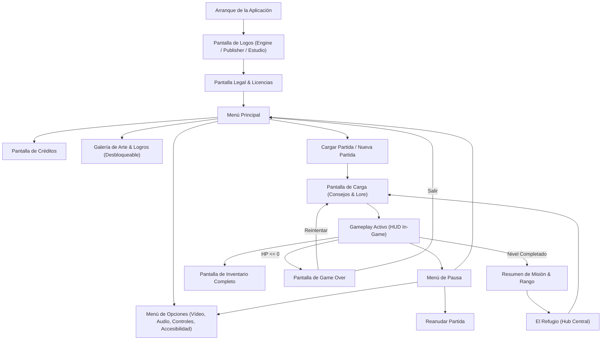

# 06.3 - Diagrama de Flujo de Pantallas (Game Flow)

> [!NOTE] Propósito de la Sección
> Esquematizar la arquitectura completa de navegación de pantallas del juego desde que se inicia la aplicación hasta la sesión in-game y los créditos.

---

## 1. Diagrama de Conexión de Pantallas

