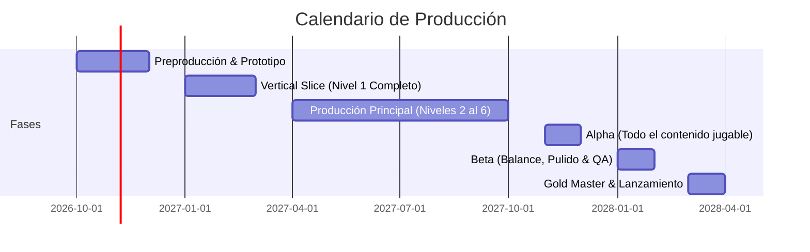

# 08.2 - Cronograma de Producción & Fases (Milestones)

> [!NOTE] Propósito de la Sección
> Definir los hitos formales del desarrollo, entregables por fase, estimaciones de tiempo y asignación del equipo.

---

## 1. Fases del Proyecto (Milestones)

### 1.1 Preproducción & Prototipo
- Mecánicas base de movimiento (correr, saltar, agacharse, patada deslizante).
- Sistema de empuje de cajas y apertura de puertas probado en Unity.
- Aprobación de la estructura del GDD en Obsidian.

### 1.2 Vertical Slice
- Nivel 01 (*Abandoned Warehouse*) terminado al 100% con arte final, audio, jefe y flujo de menús.

### 1.3 Alpha, Beta & Gold
- Cierre de contenido en Alpha; corrección masiva de bugs y balance en Beta; compilación final certificada en Gold.

---

## 2. Equipo de Desarrollo & Roles
- **Game Director / Lead Designer:** Dirección creativa y balance.
- **Lead Programmer:** Arquitectura Unity C# e IA.
- **Lead 3D & Concept Artist:** Modelado, texturizado e iluminación.
- **Level Designer:** Greyboxing y construcción de mapas.
- **Sound Designer & Compositor:** Efectos sonoros y OST adaptativa.
