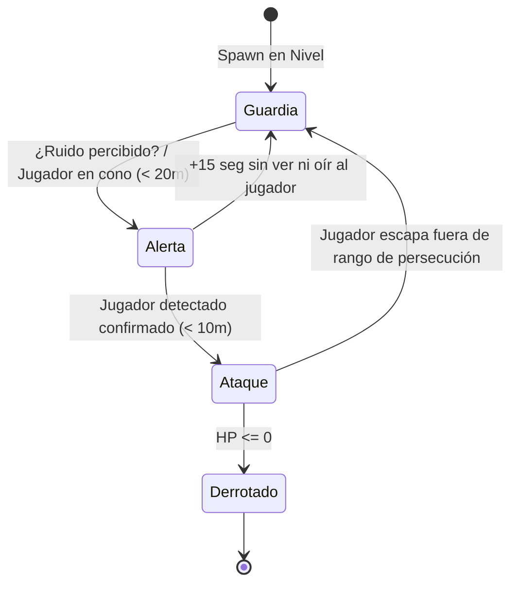

# Ficha de Enemigo: {{title}}

> [!NOTE] Propósito del Documento
> Detalla el diseño estético, parámetros de combate, máquina de estados de IA y recompensas para este enemigo.

---

## 1. Concepto & Rol en el Combate

- **Nombre del Enemigo:** {{title}}
- **Categoría:** <!-- Enemigo simple (grunty), Escudero defensivo, Asesino rápido, Tirador a distancia, Semi-jefe -->
- **Rol Táctico:** <!-- Presionar al jugador de cerca, forzar esquivas, flanquear, proteger a otros enemigos -->
- **Inspiración / Referencia:** <!-- Soldado oscuro de Dark Souls, Guardia de Shinobi, etc. -->

---

## 2. Estadísticas & Parámetros Base

| Parámetro | Valor Numérico | Observaciones de Balance |
| :--- | :--- | :--- |
| **Puntos de Vida (HP)** | `100` | <!-- Cuántos golpes del combo estándar soporta --> |
| **Armadura / Escudo** | `0` | <!-- % de mitigación o escudo rompible con patada --> |
| **Velocidad de Patrulla**| `2.0 m/s` | <!-- Velocidad en estado pasivo --> |
| **Velocidad de Persecución**| `5.0 m/s` | <!-- Velocidad en estado agresivo --> |
| **Rango de Visión (Cono)**| `15 m / 90°` | <!-- Alcance y ángulo del cono de visión --> |
| **Umbral de Detección de Ruido**| `8 m` | <!-- Distancia a la que oye pisadas normales o combate --> |
| **Tiempo de Salida de Alerta**| `15 s` | <!-- Segundos antes de volver a Guardia si pierde al jugador --> |

---

## 3. Diagrama de Estados & Comportamiento IA

### 3.1 Descripción de Estados
- **Estado GUARDIA (Patrulla / Idle):** <!-- Rutina de movimiento entre waypoints, animación neutral, escaneo de entorno -->
- **Estado ALERTA (Sospecha / Búsqueda):** <!-- Se detiene, desenfunda arma, camina hacia el origen del estímulo sonoro o visual -->
- **Estado ATAQUE (Combate Activo):** <!-- Cierra distancia, ejecuta patrones de ataque, esquiva o bloquea -->
- **Estado HITSTUN / ATURDIMIENTO:** <!-- Duración del aturdimiento al recibir golpe, posibilidad de ser derribado -->

---

## 4. Repertorio de Acciones & Ataques

| Acción / Ataque | Daño | Telegrafiado (Windup) | Área de Impacto (Hitbox) | Cooldown | ¿Se puede bloquear / esquivar? |
| :--- | :--- | :--- | :--- | :--- | :--- |
| **Golpe Básico** | `15` | `0.4 s` (Alza el brazo) | Frontal corto (`1.5 m`) | `1.0 s` | Bloqueable / Esquivable |
| **Ataque Fuerte / Cargado** | `35` | `0.9 s` (Brillo rojo) | Frontal medio (`2.5 m`) | `3.0 s` | Imbloqueable / Requiere Rodar |
| **Posición Defensiva (Bloqueo)** | `0` | Instantáneo | Frontal 180° | N/A | Rompible con Patada Deslizante |

---

## 5. Reacciones al Daño & Vulnerabilidades

- **Hitstun Leve:** <!-- Se tambalea pero no interrumpe combos consecutivos rápidos -->
- **Hitstun Pesado:** <!-- Interrumpe su ataque en curso; vulnerable durante 1.2 segundos -->
- **Vulnerabilidad Específica:** <!-- Espalda desprotegida, vulnerable a ataques aéreos, débil al fuego -->
- **Efectos de Estado:** <!-- ¿Es inmune al aturdimiento? ¿Puede ser envenenado/quemado? -->

---

## 6. Spawn, Composición de Encuentros & Recompensas

- **Aparición en Niveles:** <!-- [[05.5 - Nivel 01]], [[05.5 - Nivel 02]] -->
- **Cantidad habitual por encuentro:** <!-- Solitario / Grupos de 2-3 / Con escolta de tiradores -->
- **Recompensas al derrotar:**
  - Experiencia (XP): `XX XP`
  - Monedas: `XX - XX monedas`
  - Drop de Ítems: `X% probabilidad de Botiquín pequeño`

---

## 7. Consejos de Diseño & Estrategia para el Jugador
<!-- ¿Cómo se le enseña al jugador a combatir este enemigo por primera vez? -->
<!-- Táctica óptima: "El Soldado con Escudo obliga a usar patada deslizante para romper su guardia o rodar a su espalda." -->
