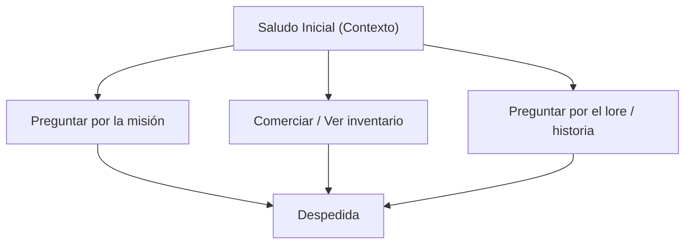

# Ficha de NPC: {{title}}

> [!NOTE] Propósito del Documento
> Define el perfil, árbol de diálogo, función mecánica y recompensas de un Personaje No Jugable (NPC).

---

## 1. Perfil & Apariencia
- **Nombre:** {{title}}
- **Rol en el Juego:** <!-- Aliado de combate, Informante de lore, Comerciante, PNJ de escolta -->
- **Ubicación en el Mundo:** <!-- Nivel o Hub donde se encuentra -->
- **Descripción Visual:** <!-- Ropa, complexión, accesorios, postura -->
- **Personalidad & Tono:** <!-- Amable, desconfiado, cómico, misterioso -->

---

## 2. Función Mecánica
- [ ] **Diálogo / Lore:** Provee información del mundo y consejos tácticos.
- [ ] **Dador de Misiones (Quest Giver):** Entrega misiones principales o secundarias.
- [ ] **Comerciante:** Compra y venta de objetos y mejoras.
- [ ] **Mecánica de Escolta:** Posee barra de vida propia y debe ser protegido por el jugador.

---

## 3. Diálogos Clave & Estructura

### Líneas de Diálogo
- **Primer Encuentro:**
  > "..."
- **Durante la Misión:**
  > "..."
- **Al Completar la Misión:**
  > "..."
- **Diálogo Repetido / Idle:**
  > "..."

---

## 4. Recompensas Asociadas
- **Al Interactuar / Ayudar:** <!-- Ítems, llaves, mejoras de equipo, acceso a zonas secretas -->
