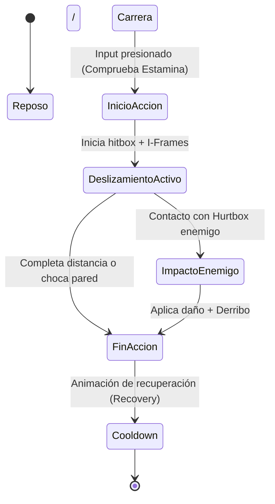

# Mecánica: {{title}}

> [!NOTE] Propósito del Documento
> Especifica una mecánica de juego de forma precisa: reglas, inputs, fórmulas matemáticas, feedback audiovisual, casos límite y relación con la arquitectura técnica.

---

## 1. Definición & Propósito

- **Descripción Resumida:** <!-- ¿Qué es la mecánica en una frase? (Ej: Patada deslizante para evasión y derribo bajo) -->
- **Propósito de Diseño:** <!-- ¿Por qué existe en el juego? ¿Qué dinámica genera? (Ej: Ofrecer una alternativa ágil al salto para sortear trampas bajas y romper posturas) -->
- **Estética MDA Vinculada:** <!-- Desafío, Sensación de maestría, Expresión táctica -->

---

## 2. Reglas de Funcionamiento & Parámetros

### 2.1 Condiciones de Activación (Inputs)
- **Botón Requerido:** <!-- Ej: Salto + Triángulo en PS4, Espacio + C en PC -->
- **Estado Requerido del Personaje:** <!-- Debe estar corriendo en el suelo; no operable en el aire ni agachado en reposo -->
- **Consumo de Recursos:** <!-- Gasta 15 puntos de estamina -->

### 2.2 Variables Numéricas & Tiempos
| Parámetro | Valor | Unidad / Explicación |
| :--- | :--- | :--- |
| **Duración Total de la Acción** | `0.85` | Segundos |
| **Ventana de Inmunidad (I-Frames)**| `0.25` | Segundos desde el inicio de la animación |
| **Velocidad de Desplazamiento** | `8.0` | Metros por segundo (deceleración lineal) |
| **Distancia Recorrida** | `4.5` | Metros |
| **Daño al Contacto** | `20` | Puntos de vida al impactar contra enemigos |
| **Cooldown / Enfriamiento** | `0.5` | Segundos antes de poder volver a ejecutarse |

---

## 3. Diagrama de Estados de la Mecánica

---

## 4. Feedback Audiovisual (Game Feel)

- **Animación:** <!-- Nombre de la animación, pose de inicio y recuperación -->
- **VFX (Efectos Visuales):** <!-- Polvo en el suelo al deslizarse, estela blanca en las piernas, chispas al golpear -->
- **SFX (Efectos de Sonido):** <!-- Sonido de fricción rápida contra el suelo, golpe seco al impactar enemigo -->
- **Feedback Háptico / Cámara:** <!-- Vibración ligera en el mando; pequeño tirón dinámico de cámara hacia adelante -->

---

## 5. Casos Límite (Edge Cases) & Restricciones

- **¿Qué pasa al chocar contra una pared o superficie sólida?** <!-- Detiene inmediatamente el desplazamiento y reproduce animación de choque leve sin aturdimiento -->
- **¿Qué pasa al llegar al borde de una plataforma o precipicio?** <!-- Cae al vacío manteniendo la inercia horizontal pero perdiendo la hitbox activa -->
- **¿Se puede cancelar con otra acción?** <!-- No cancelable hasta completar el frame 70% de la animación -->

---

## 6. Integración Técnica (Unity C#)
- **Scripts Afectados:** `ExplorationController.cs`, `CombatManager.cs`
- **Componentes Necesarios:** `CharacterController` o `Rigidbody2D / 3D`, `Collider` de tipo Trigger para la hitbox.
