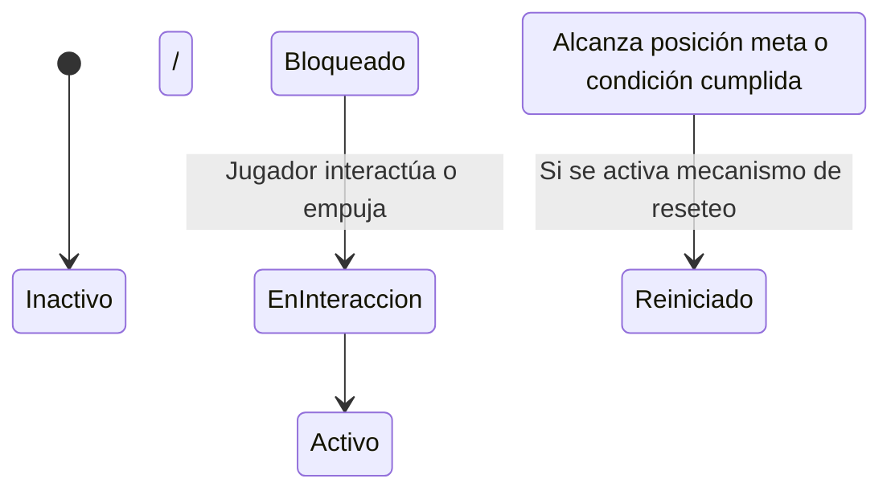

# Interactuable / Puzle: {{title}}

> [!NOTE] Propósito del Documento
> Especifica los objetos interactuables del entorno, sus reglas físicas o lógicas, estados posibles y feedback.

---

## 1. Concepto & Función

- **Nombre:** {{title}}
- **Tipo de Objeto:** <!-- Caja pesada, escalera de mano fija/desplegable, placa de presión, puerta metálica, muro rompible -->
- **Rol en el Juego:** <!-- Bloquear paso, servir de escalón para alcanzar altura, conectar dos plantas, activar mecanismos -->

---

## 2. Reglas de Interacción & Controles

- **Distancia de Detección:** <!-- Ej: 1.5 metros frente al objeto -->
- **Botón de Interacción:** <!-- Botón de interacción sostenido o empuje físico mediante colisión -->
- **Restricciones del Personaje:** <!-- Mientras empuja una caja, la velocidad se reduce a 1.2 m/s y no puede atacar ni saltar -->

---

## 3. Máquina de Estados del Objeto

---

## 4. Feedback Audiovisual

- **Indicador Visual (Prompt UI):** <!-- Icono emergente flotante sobre el objeto ("Mantén R2 para empujar") -->
- **VFX:** <!-- Partículas de polvo al arrastrarse, destello luminoso al encajar en la posición correcta -->
- **SFX:** <!-- Chirrido de piedra/metal contra el suelo, clic mecánico de encaje -->

---

## 5. Implementación en Niveles & Variantes
- **Niveles donde aparece:** <!-- [[05.5 - Nivel 01]], [[05.5 - Nivel 03]] -->
- **Scripts Técnicos:** `PushableBox.cs`, `BoxDestinationPoint.cs`, `DoorInteractable.cs`, `LadderZone.cs`
